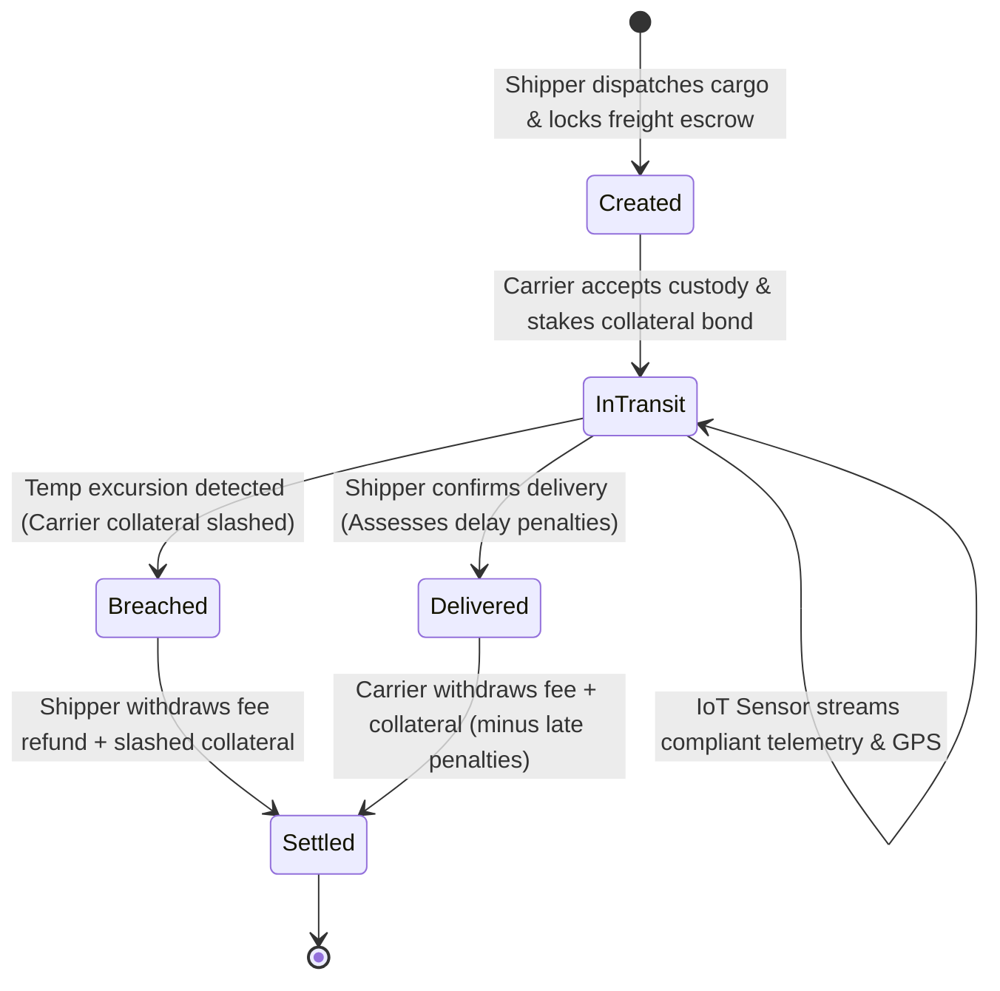
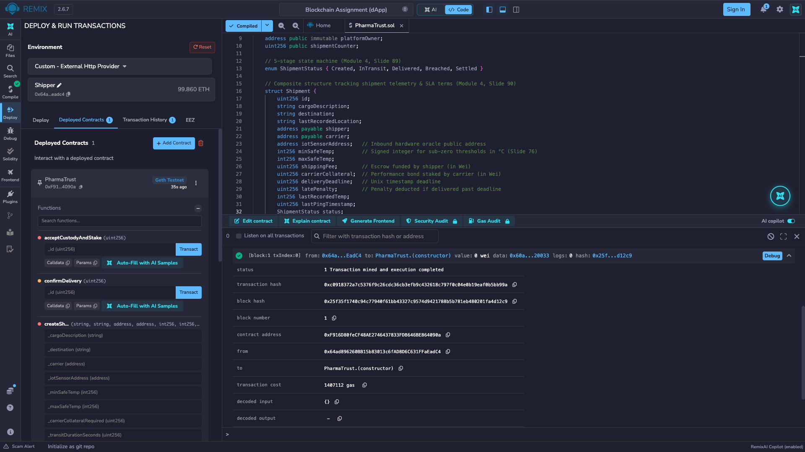
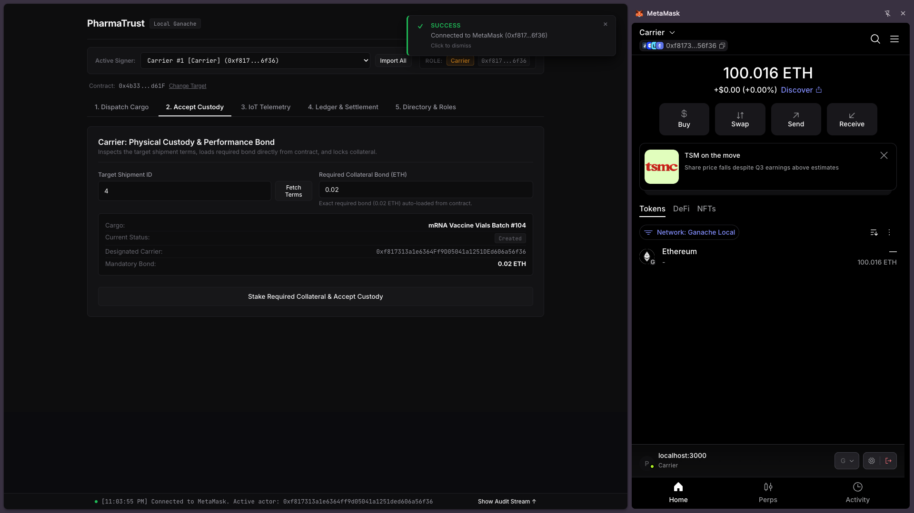
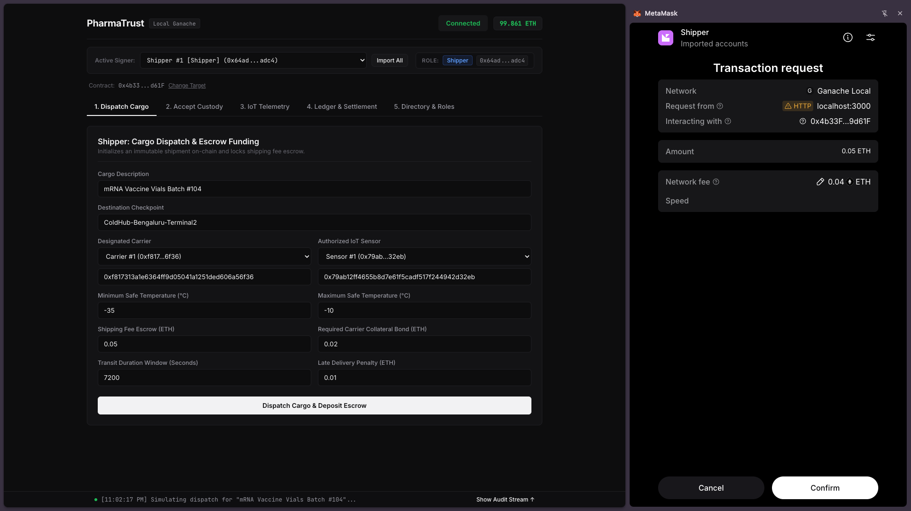
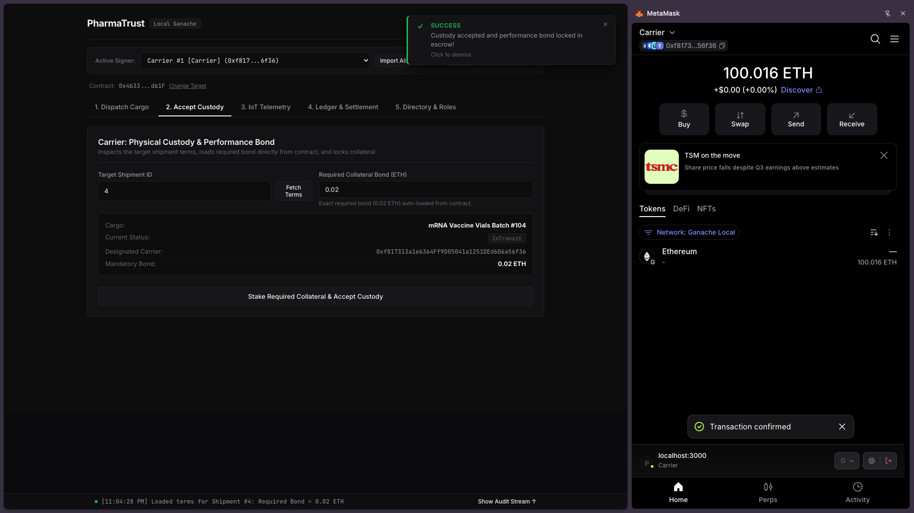
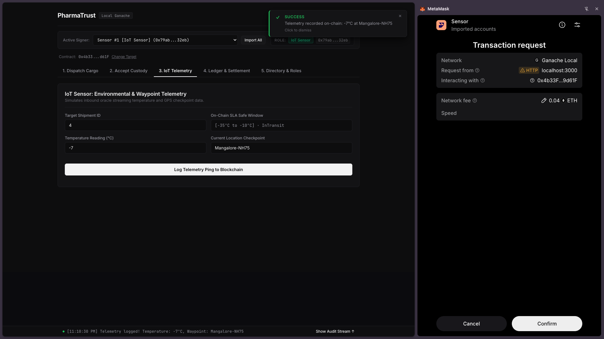
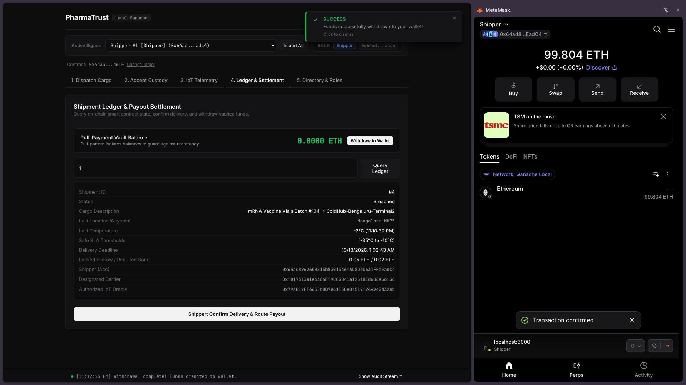
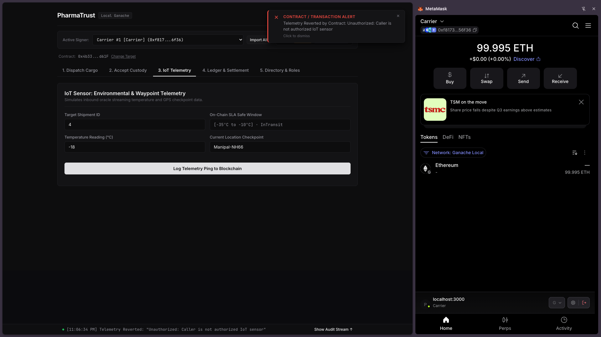
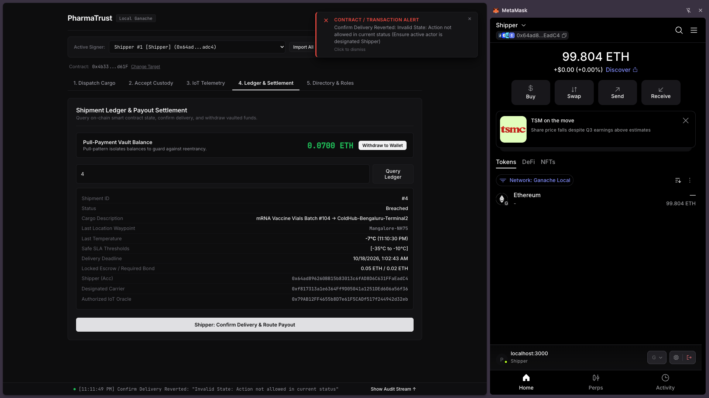
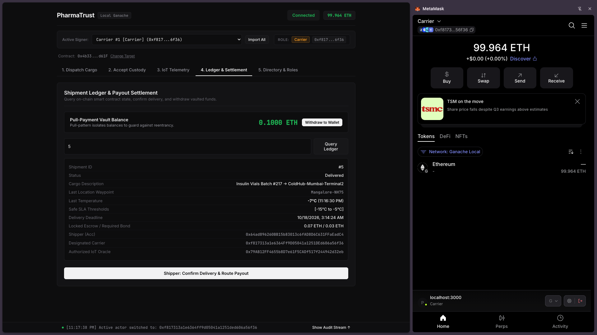

# PharmaTrust: Decentralized Cold-Chain Telemetry & Autonomous SLA Escrow DApp

PharmaTrust is a decentralized application designed to eliminate trust deficits and dispute cycles in pharmaceutical supply chains. The smart contract acts as an automated escrow and service-level-agreement (SLA) enforcement protocol for temperature-sensitive cargo (e.g., mRNA vaccines, insulin, biological reagents).

By integrating an inbound IoT hardware oracle that streams real-time environmental temperature and GPS checkpoint data, the smart contract autonomously penalizes logistics breaches—slashing the carrier's staked performance bond and issuing a full refund to the shipper upon thermal failure, or deducting delay penalties if deliveries miss agreed deadlines.

---

## 1. Problem Statement & System Architecture

### The Cold-Chain Problem
Biological drugs and vaccines lose efficacy or become toxic if exposed to temperatures outside strict tolerances (e.g., -25°C to -15°C). In traditional centralized logistics:
* Carriers can conceal refrigeration failures or unauthorized engine-off stops.
* Shippers struggle to enforce financial accountability due to protracted legal arbitration.
* Unexcused route delays and demurrage disputes frequently stall payments.

### The PharmaTrust Solution
PharmaTrust implements an autonomous state-machine escrow governed by on-chain cryptographic rules:
1. **Payable Dual-Lock Escrow:** The shipper deposits the freight fee into escrow, while the carrier stakes a refundable collateral penalty bond.
2. **Inbound Hardware Oracle Telemetry:** An authorized onboard IoT sensor key-pair transmits signed temperature readings and GPS location waypoints.
3. **Autonomous SLA Penalization:** If a temperature excursion occurs, the contract automatically slashes 100% of the carrier's collateral and refunds the shipper.
4. **Time-Bounded Delay Penalties:** If transit succeeds thermally but exceeds the transit duration deadline (`deliveryDeadline`), an on-chain late penalty is deducted and refunded to the shipper.
5. **Pull-over-Push Vault Isolation:** Withdrawable balances are quarantined in `pendingWithdrawals`, neutralizing reentrancy attacks.

### State Transition Lifecycle



---

## 2. Smart Contract Architecture & Solidity Mechanics

The smart contract (`PharmaTrust.sol`) implements core Ethereum concepts from the **Module 4 syllabus**:

* **State Machine (`enum ShipmentStatus`):** Restricts operational flow across five discrete stages: `Created`, `InTransit`, `Delivered`, `Breached`, and `Settled`.
* **Composite Record (`struct Shipment`):** Encapsulates shipment metadata, participants, financial commitments, telemetry thresholds, and tracking status.
* **Signed Integers (`int256`):** Accommodates sub-zero pharmaceutical storage requirements down to -35°C.
* **Inbound Hardware Oracle Pattern:** Authenticates real-world sensor streams using a designated public key address (`iotSensorAddress`) representing the physical telematics unit.
* **Time-Bounded Execution:** Uses `block.timestamp` to compute dynamic deadlines (`block.timestamp + _transitDurationSeconds`) and enforce late penalties.
* **Payable Dual Escrow:** Accepts and tracks native Ether across multiple actors using `msg.value`.
* **Pull-Payment Pattern:** Replaces direct transfers with a `pendingWithdrawals` mapping, preventing reentrancy vulnerabilities and unintended transaction reverts.
* **Role-Based Access Modifiers:** Enforces strict execution rights via `onlyShipper`, `onlyCarrier`, `onlySensor`, and state check `inStatus`.
* **Event Logging:** Emits indexed events (`ShipmentCreated`, `CustodyAccepted`, `TelemetryLogged`, `SLABreached`, `ShipmentDelivered`, `FundsWithdrawn`) for asynchronous UI consumption.

---

## 3. Network & Deployment Specifications

* **Target Network:** Ganache Local Blockchain (or Sepolia Testnet)
* **RPC Server Endpoint:** `http://127.0.0.1:7545`
* **Network / Chain ID:** `1337` (or `5777` matching local Ganache instance)
* **Deployed Smart Contract Address:** `0x4b33F052c92b23a54b38d3885f8C39F9d9d61F`
* **Solidity Compiler Version:** `0.8.20+commit.a1b79de6`
* **EVM Execution Environment:** Injected Provider (MetaMask)
* **Compiler Configuration:** **You must compile using the provided [`contracts/remix.config.js`](contracts/remix.config.js)** (or enable `viaIR: true`, Optimizer: `200 runs`, and EVM Version: `paris` in Remix Advanced Configurations) to eliminate the EVM `Stack too deep` error.

> [!TIP]
> **Complete Installation & Operational Walkthrough:**
> For step-by-step instructions on setting up Ganache, importing MetaMask keys, deploying, and simulating shipments, refer to the [**Setup & Deployment Guide (`SETUP_GUIDE.md`)**](SETUP_GUIDE.md).

---

## 4. Repository Structure

```text
PharmaTrust-DApp/
├── contracts/
│   ├── PharmaTrust.sol            # Smart contract with state machine, oracle & SLA logic
│   └── remix.config.js            # Mandatory Remix IDE configuration (viaIR & optimizer)
├── frontend/
│   ├── index.html                 # Semantic HTML5 user interface
│   ├── style.css                  # Responsive UI component styles
│   └── app.js                     # Ethers.js v6 integration & MetaMask interaction logic
├── screenshots/                   # Verification evidence required by assignment rubric
│   ├── 01_remix_compilation_and_deployment.png
│   ├── 02_metamask_connection.png
│   ├── 03_successful_dispatch_tx.png
│   ├── 04_custody_acceptance_confirmed.png
│   ├── 05_failed_tx_unauthorized_sensor.png
│   ├── 06_sla_breach_telemetry.png
│   ├── 07_ui_data_retrieval_breached.png
│   ├── 08_failed_tx_invalid_state.png
│   ├── 09_pull_vault_withdrawal.png
│   └── 10_ui_data_retrieval_delivered.png
├── test/
│   ├── PharmaTrust.test.js        # Automated Hardhat / Mocha test suite
│   └── test_cases_report.md       # Documented validation matrix with observed results
├── .gitignore
├── hardhat.config.js              # Hardhat configuration
├── package.json                   # Project metadata and development dependencies
├── SETUP_GUIDE.md                 # Complete local setup and deployment walkthrough
└── README.md                      # Comprehensive project documentation
```

---

## 5. Comprehensive Test Validation Matrix

The application underwent verification covering valid executions, invalid parameter rejections, and unauthorized access attempts in compliance with Section 1(v) of the assignment specifications:

| Test ID | Test Category | Target Function | Parameters / Caller | Expected Behavior | Observed Result | Status |
| :--- | :--- | :--- | :--- | :--- | :--- | :---: |
| **TC-01** | Valid Input | `createShipment` | **Caller:** Shipper (`0x64ad...`)<br>Fee: `0.05 ETH`, Bond: `0.02 ETH`<br>Limits: `[-35°C, -10°C]`, Dur: `7200s` | Shipment initialized in `Created` status; `0.05 ETH` locked in contract escrow; emits `ShipmentCreated`. | Mined in block; UI indicates successful dispatch and updates signer balance. | **PASS** |
| **TC-02** | Valid Payable | `acceptCustodyAndStake` | **Caller:** Carrier (`0xf817...`)<br>ID: `4`, `msg.value: 0.02 ETH` | Carrier locks exact required collateral bond; state transitions from `Created` to `InTransit`. | Bond vaulted on-chain; UI status badge updates to `InTransit`. | **PASS** |
| **TC-03** | Valid Telemetry | `logTelemetry` | **Caller:** Sensor (`0x79ab...`)<br>ID: `4`, Temp: `-18°C`, Loc: `"Manipal-NH66"` | Telemetry recorded on-chain; within safe bounds; status remains `InTransit`. | Transaction confirmed; UI shows updated checkpoint and timestamp. | **PASS** |
| **TC-04** | Autonomous SLA Breach | `logTelemetry` | **Caller:** Sensor (`0x79ab...`)<br>ID: `4`, Temp: `-7°C` (violates `-10°C` max) | Temperature excursion detected; status transitions to `Breached`; carrier bond slashed; `0.07 ETH` credited to Shipper vault. | Emits `SLABreached`; UI updates status to `Breached`; Shipper vault reflects `0.0700 ETH`. | **PASS** |
| **TC-05** | Valid Pull Withdrawal | `withdrawVault` | **Caller:** Shipper (`0x64ad...`)<br>Vault Balance: `0.0700 ETH` | Contract transfers `0.07 ETH` to Shipper wallet; resets internal vault balance to zero. | Transaction mined; wallet balance increases; UI vault balance resets to `0.0000 ETH`. | **PASS** |
| **TC-06** | On-Time Delivery Settlement | `confirmDelivery` | **Caller:** Shipper (`0x64ad...`)<br>ID: `5`, Transit time within deadline | Status transitions to `Delivered`; `0.1000 ETH` (`0.07 fee + 0.03 bond`) routed to Carrier vault with zero delay penalty. | Emits `ShipmentDelivered`; Carrier vault balance updates to `0.1000 ETH`. | **PASS** |
| **TC-07** | Delayed Delivery Penalty | `confirmDelivery` | **Caller:** Shipper (`0x64ad...`)<br>Condition: `block.timestamp > deliveryDeadline` | On-chain clock validates late delivery; `latePenalty` is deducted and refunded to Shipper; remainder routed to Carrier. | Penalty split calculated accurately; Shipper pull-vault credited with penalty amount. | **PASS** |
| **TC-08** | Invalid Input (Inverted Bounds) | `createShipment` | **Caller:** Shipper (`0x64ad...`)<br>`minSafeTemp: -10°C`, `maxSafeTemp: -20°C` | Validation check `maxSafeTemp > minSafeTemp` fails; transaction reverts. | Reverts with `"Invalid Input: Max temp must exceed min temp"`; state unchanged. | **PASS** |
| **TC-09** | Invalid Value (Underpaid Bond) | `acceptCustodyAndStake` | **Caller:** Carrier (`0xf817...`)<br>ID: `4`, `msg.value: 0.005 ETH` (Required: `0.02`) | Validation check `msg.value == carrierCollateral` fails; transaction reverts. | Reverts with `"Invalid Value: Exact collateral bond required"`; no funds locked. | **PASS** |
| **TC-10** | Unauthorized Sensor Access | `logTelemetry` | **Caller:** Carrier (`0xf817...`)<br>Target ID: `4`, Temp: `-18°C` | Access modifier `onlySensor` halts execution; unauthorized account cannot log telemetry. | Transaction reverts with `"Unauthorized: Caller is not authorized IoT sensor"`. | **PASS** |
| **TC-11** | Unauthorized Carrier Custody | `acceptCustodyAndStake` | **Caller:** Shipper (`0x64ad...`)<br>Target ID: `5` (Designated Carrier: `0xf817...`) | Access modifier `onlyCarrier` halts execution; non-designated account cannot accept custody. | Transaction reverts with `"Unauthorized: Caller is not designated carrier"`. | **PASS** |
| **TC-12** | Invalid State Transition | `confirmDelivery` | **Caller:** Shipper (`0x64ad...`)<br>Target ID: `4` (Current Status: `Breached`) | State modifier `inStatus(_id, ShipmentStatus.InTransit)` halts execution on breached cargo. | Transaction reverts with `"Invalid State: Action not allowed in current status"`. | **PASS** |

---

## 6. Verification Evidence & Submission Screenshots

The following visual documentation satisfies all verification criteria outlined in **Step 2 (Item 3)** of the Assignment 2 submission protocol:

### 6.1 Smart Contract Compilation & Deployment



*Figure 1: Remix IDE terminal displaying successful compilation under Solidity 0.8.20 and on-chain contract creation (`PharmaTrust.constructor`) with contract address `0xF916...090a` / `0x4b33...d61F` on Ganache Local RPC.*

---

### 6.2 MetaMask Wallet Connection & Active Role Ingestion



*Figure 2: PharmaTrust frontend connecting to MetaMask on Ganache Local (`Chain ID 1337`), displaying active signer role (`Carrier #1: 0xf817...6f36`) and loaded wallet balance (`100.016 ETH`).*

---

### 6.3 Successful Transactions (Escrow, Bond, Telemetry & Settlement)



*Figure 3: Shipper creating Shipment #4 ("mRNA Vaccine Vials Batch #104") and funding 0.05 ETH into escrow via MetaMask transaction prompt.*



*Figure 4: Carrier accepting physical custody, staking 0.02 ETH performance bond, and advancing on-chain state to InTransit with mined transaction receipt.*



*Figure 5: Inbound hardware oracle streaming an out-of-bounds temperature (-7°C at Mangalore-NH75), logging the data on-chain and triggering autonomous SLA penalty enforcement.*



*Figure 6: Shipper executing `withdrawVault()` to claim the 0.0700 ETH penalty payout (0.05 fee refund + 0.02 slashed carrier bond), successfully transferring ETH to the wallet.*

---

### 6.4 Failed Transactions (Negative Testing: Unauthorized & Invalid Inputs)



*Figure 7: Revert alert triggered when Carrier #1 attempts to spoof sensor data on Shipment #4: "Unauthorized: Caller is not authorized IoT sensor".*



*Figure 8: Revert alert triggered when Shipper attempts to execute delivery confirmation on an already Breached shipment: "Invalid State: Action not allowed in current status".*

---

### 6.5 Blockchain Data Displayed Through User Interface


*Figure 9: Live audit query of Shipment #4 displaying on-chain state: Status `Breached`, last recorded temperature `-7°C`, and pull-vault balance updated to `0.0700 ETH`.*



*Figure 10: Live audit query of Shipment #5 displaying on-chain state: Status `Delivered`, destination `ColdHub-Mumbai-Terminal2`, and carrier pull-vault credited with full `0.1000 ETH` payout.*

---

## 7. Security Auditing & Academic Compliance

* **Credential Safety Guarantee:** In accordance with Step 2, Item 5 of the assignment brief, this repository does not contain raw private keys, wallet seed phrases, mnemonic passphrases, or sensitive credential files.
* **Reentrancy Protection:** All financial disbursements strictly adhere to the Checks-Effects-Interactions / Pull-Payment pattern. State updates precede external value calls, and withdrawable balances are quarantined in `pendingWithdrawals`.
* **Integer Arithmetic:** Negative temperatures are handled safely using native Solidity signed integer primitives (`int256`) with EVM overflow checks enabled by default.
* **Hardware Oracle Integrity:** External sensor telemetry is cryptographically restricted to a pre-registered Ethereum public address, preventing off-chain data fabrication by unauthenticated network peers.
